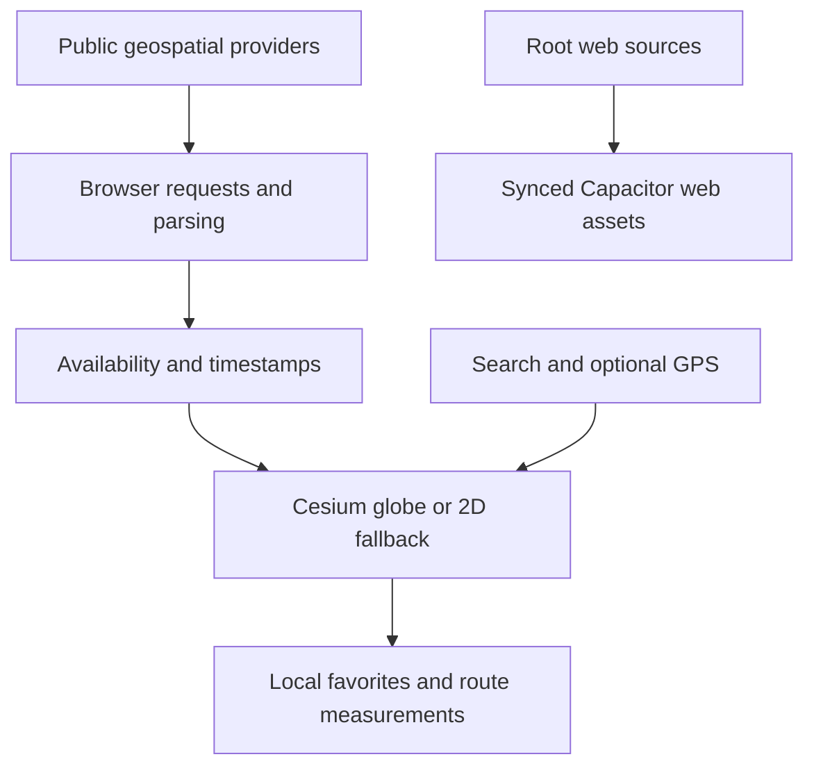

# AEGIS Earth Mobile — Studio Niko Design

**Public geospatial data explorer · CesiumJS 3D / 2D fallback · PWA and Android development build**

[](index.html) · [Android configuration](capacitor.config.json) · [English overview](#english-overview)

## Architecture réelle



| Source | Fonction constatée |
| --- | --- |
| [index.html](index.html) | Globe CesiumJS 1.132, distances sphériques, couches USGS/NASA/ISS, recherche et repli 2D |
| [extras.js](extras.js) | Adaptateurs météo, air, caméras publiques et autres flux publics ; import GeoJSON |
| [scripts/sync-web.mjs](scripts/sync-web.mjs) | Synchronisation des sources web vers Capacitor |
| [package.json](package.json) | Capacitor 7, scripts de vérification et de compilation |
| [sw.js](sw.js) | Cache du shell applicatif |

Le calcul de distance utilise la formule de Haversine sur une sphère ; il ne s'agit pas d'un calcul d'itinéraire routier ni d'une mesure géodésique certifiée. Les réponses des fournisseurs sont partielles et peuvent échouer. Les horodatages de réception ne prouvent pas la fraîcheur des observations à la source.

Application géospatiale **mobile-first** pour Android (PWA / Capacitor) et navigateur, inspirée de [God's Eye View](https://github.com/bilawalsidhu/gods-eye-view).

## Nouveautés v0.5 : caméras et données publiques

- **Caméras de circulation TfL (Londres)** : emplacements officiels JamCams, aperçus JPEG et vidéos MP4 lorsqu'ils sont proposés. Les images sont renouvelées périodiquement par TfL et peuvent être indisponibles ; aucune caméra privée n'est intégrée.
- **Avions à proximité (ADS-B)** : tentative de récupération depuis l'API publique Airplanes.live dans un rayon de 150 NM autour du centre de carte. Ce flux peut être limité ou refusé par CORS : aucun avion n'est inventé et un lien vers la carte du fournisseur est proposé.
- **Météo et air** : prévisions locales Open-Meteo et qualité de l'air (AQI, PM2.5, PM10), sur demande et avec mention du caractère modélisé.
- **Météo spatiale** : dernières observations Kp NOAA SWPC. L'ISS reste dans les couches historiques.
- **Navires** : liens vers les cartes maritimes externes et import local GeoJSON de points géolocalisés. Ce n'est **pas** un flux AIS en direct. Un relais avec clé AISStream est nécessaire pour offrir ce suivi dans l'application.
- Les onglets sont défilables horizontalement sur Android. Les nouvelles couches utilisent la même version de code sur Pages et Capacitor.

Les services distants sont sollicités par le navigateur et peuvent ne pas autoriser l'accès CORS, même s'ils répondent depuis leur site officiel. Les images et vidéos appartiennent à leurs fournisseurs et leurs conditions d'utilisation doivent être respectées. La version GitHub Pages n'utilise pas de secrets ni d'identifiants API.

**Sources** : [TfL JamCams](https://tfl.gov.uk/info-for/open-data-users/our-open-data), [Airplanes.live](https://airplanes.live/api-docs/), [Open-Meteo](https://open-meteo.com/en/docs), [Open-Meteo Air Quality](https://open-meteo.com/en/docs/air-quality-api), [NOAA SWPC](https://www.spaceweather.gov/content/data-access), [AISStream](https://aisstream.io/documentation/).

## APK Android public (version de test)

[**Télécharger l’APK Android AEGIS Earth Mobile v0.5**](https://github.com/Nikoju1977/aegis-earth-mobile/releases/download/v0.5.0-android-preview/AEGIS-Earth-Mobile-v0.5-android-debug.apk)

La [publication GitHub v0.5.0-android-preview](https://github.com/Nikoju1977/aegis-earth-mobile/releases/tag/v0.5.0-android-preview) est publique. Ce paquet est une **version de développement** compilée par GitHub Actions, et non une version signée pour Google Play. Pour l’installer sur Android, télécharger l’APK et autoriser temporairement l’installation depuis la source utilisée. Une future mise à jour peut nécessiter de désinstaller l'ancienne application si les certificats debug diffèrent. Sauvegarder d’abord les favoris locaux.

## GitHub Pages

**Site prévu :** https://nikoju1977.github.io/aegis-earth-mobile/

Cette URL devient accessible après activation de Pages et réussite du workflow. La publication n'est pas active automatiquement par la seule création des fichiers.

1. Ouvrir **Settings → Pages** dans ce dépôt.
2. Sous **Build and deployment → Source**, sélectionner **GitHub Actions**.
3. Ouvrir **Actions → Deploy AEGIS Earth to GitHub Pages**. Si aucune exécution réussie n'a suivi le réglage, lancer **Run workflow**.
4. Vérifier l'URL dans l'onglet Pages ou dans l'exécution du workflow.

Le workflow se trouve dans [.github/workflows/pages.yml](.github/workflows/pages.yml) et republie automatiquement après les mises à jour de main.

## Fonctions Pages (édition statique)

- Globe 3D CesiumJS avec imagerie Esri et navigation tactile.
- Séismes USGS (magnitudes 2,5+ sur 24 h) et événements ouverts NASA EONET.
- Position ISS via Where The ISS At, selon disponibilité et politiques CORS.
- Activation des couches, radar trié par distance, recherche de lieux par Photon.
- Géolocalisation après consentement, mesure de routes en kilomètres.
- Enregistrement/export de lieux via le stockage local.
- PWA installable en raccourci depuis Chrome Android ; mise en cache limitée des assets de l'application.

**Important : GitHub Pages est statique.** Les requêtes aux API ont lieu directement depuis le navigateur, donc les fournisseurs peuvent refuser CORS, limiter les requêtes ou être indisponibles. L'application indique alors l'indisponibilité (ou une archive temporaire de session) ; elle ne simule pas de données « temps réel ». Le chargement des tuiles et du moteur Cesium nécessite Internet et dépend de services tiers. Les mentions « SOURCES » indiquent des réponses réussies, pas un flux continu seconde par seconde.

La **V2 complète avec serveur Node**, fournie antérieurement dans l'archive de la conversation, n'est **pas intégralement copiée dans ce dépôt** : cette publication est une édition web autonome adaptée à Pages. Les fonctionnalités avec proxy telles que les avions ADS-B, certains indices météo, les fonctions spécifiques du serveur et le suivi avancé requièrent encore l'intégration du backend.

## Android

Un projet Capacitor est paramétré (dossier www/). Pour compiler manuellement :

```bash
npm install
npx cap add android
npx cap sync android
npx cap open android
```

Android Studio et le SDK Android doivent être installés.

Le workflow [Android Debug APK](.github/workflows/android-debug-apk.yml) peut aussi être lancé depuis **Actions → Android Debug APK → Run workflow**. Il compile une application de développement utilisant l'édition statique. L'APK n'est pas signé pour le Play Store ; aucune compilation réussie n'est affirmée tant que les logs GitHub Actions ne la confirment.

## Parité Android / GitHub Pages (v0.5)

Le **site public à la racine** (`index.html`, `manifest.webmanifest`, `sw.js`, `icon.svg`, `extras.js`, `extras.css`) est la source unique des fichiers web. Le dossier `www/` est une copie synchronisée destinée à Capacitor. Ne pas modifier manuellement `www/`.

```bash
npm install
npm run sync:web
npm run check:web
npm test
npm run android:add
npm run android:sync
```

Le workflow [Android Debug APK](.github/workflows/android-debug-apk.yml) exécute ces vérifications avant `assembleDebug` lorsque les sources Android/web changent sur `main`, ou manuellement via **Actions → Android Debug APK → Run workflow**. Si la compilation réussit, récupérez l'artefact `aegis-earth-mobile-debug-apk` dans le workflow réussi, extrayez `app-debug.apk`, puis installez-le sur Android après autorisation d'installation depuis cette source.

**APK de test uniquement** : signé avec la clé de développement de GitHub Actions, sans mise en production Play Store. La clé debug peut varier entre compilations ; une future installation par-dessus l'ancienne peut nécessiter une désinstallation. Sauvegardez les favoris avant toute désinstallation : leurs données sont conservées sur l'appareil.

**Périmètre identique, pas de backend magique** : Android utilise la même édition statique que Pages. Les caméras publiques TfL peuvent présenter des images/vidéos fournies par leur réseau. Les avions ADS-B sont essayés directement auprès d'Airplanes.live mais peuvent être bloqués par CORS. Un flux AIS en temps réel, la couverture mondiale de webcams via API et les autres flux avec clés privées nécessitent un serveur. Les services web externes (notamment Cesium et les API publiques) nécessitent Internet.

## Sources et limites

CesiumJS : moteur de globe ; Esri World Imagery : fond de carte (crédits sur la carte) ; USGS : séismes ; NASA EONET : événements ; Where The ISS At : ISS ; Photon / OpenStreetMap : recherche. Les sources sont soumises à leurs licences, quotas et conditions d'utilisation. Les couches ne sont pas exhaustives.

Aucun backend de collecte privé n'est établi dans cette édition ; les requêtes vers les services tiers peuvent toutefois transmettre la zone consultée et des informations de connexion. Les favoris restent dans le stockage du navigateur. Le GPS exige une autorisation explicite. Cette application ne fournit ni système de surveillance ni accès à des caméras privées.

**Licence :** adapter/clarifier les licences des dépendances et des fonds de cartes avant toute diffusion commerciale. Le code de cette édition est fourni ici à des fins de développement et de test.

## Repli 2D sans WebGL — novembre 2026

Quand le navigateur n'expose pas WebGL ou que Cesium ne s'initialise pas, l'application présente maintenant une carte 2D intégrée fondée sur OpenStreetMap, avec liens vers les observations publiques reçues et accès aux outils de recherche. Le bouton « Réessayer en 3D » tente également le miroir jsDelivr si la bibliothèque principale n'est pas disponible. Les mesures sur le globe restent désactivées en mode 2D (elles ne sont pas simulées).

L'affichage des tuiles OpenStreetMap nécessite un accès réseau ; un lien vers la carte complète reste visible. La version Android Capacitor `www/` est synchronisée sur les fichiers de la racine, et le cache PWA a été renouvelé. **Aucun essai WebGL ni sur téléphone physique n'est revendiqué pour ce correctif.**


## Qualification proposée — géospatial et confidentialité

Sur des données synthétiques, vérifier le rejet de coordonnées invalides, les distances de référence, le repli sans WebGL, les états d'indisponibilité, les imports et exports ainsi que la parité des sources Android et web. Examiner la transmission des coordonnées aux fournisseurs et la protection des favoris locaux ; la géolocalisation requiert une permission et les services externes peuvent recevoir la zone de consultation. Ne pas utiliser pour des décisions de navigation, d'urgence ou de surveillance de personnes.

Le manifeste [package.json](package.json) indique MIT ; aucun fichier de licence autonome n'a été identifié à la racine inspectée. Clarifier les droits applicables avant redistribution, en conservant les attributions du projet d'inspiration, des bibliothèques et des données. Aucun changement de licence effectué.

## English overview

AEGIS Earth Mobile is an exploratory geospatial viewer with CesiumJS, a 2D fallback, public data adapters, spherical distances and local favorites. Its Android development edition uses synchronized web assets through Capacitor. Data availability and completeness depend on external services. No private camera access or live AIS backend is implemented. Location-related requests can disclose coordinates to providers. Do not use this prototype for safety-critical navigation or surveillance. No new API, WebGL, device, APK or deployment tests were performed in this documentation revision.
